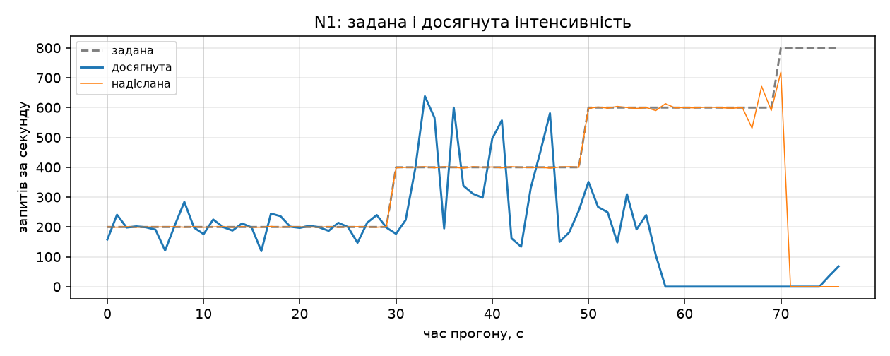
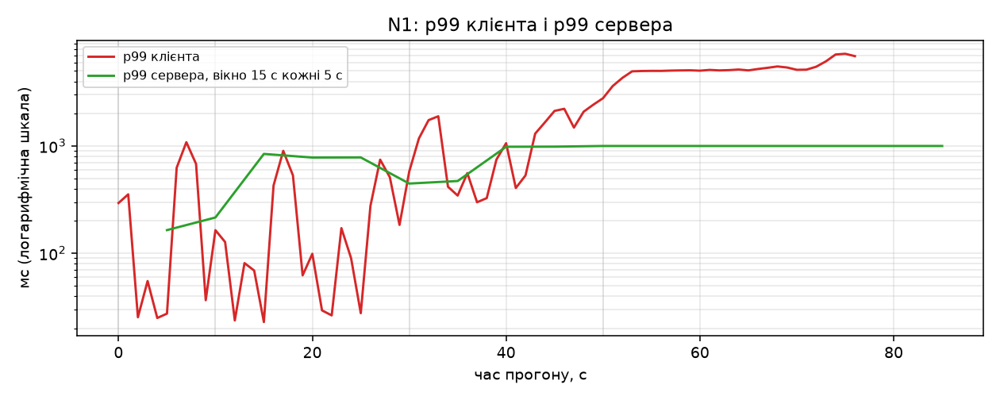
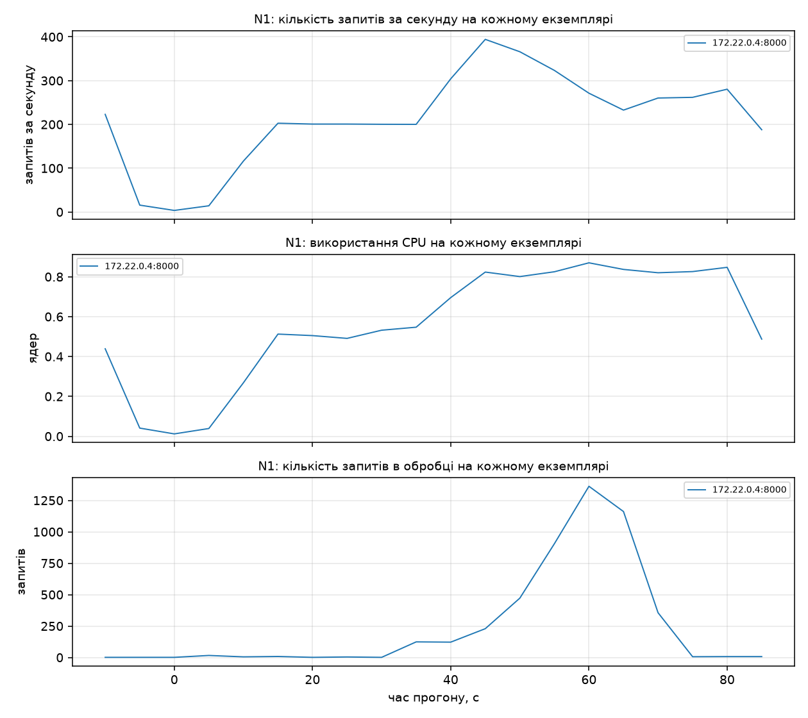
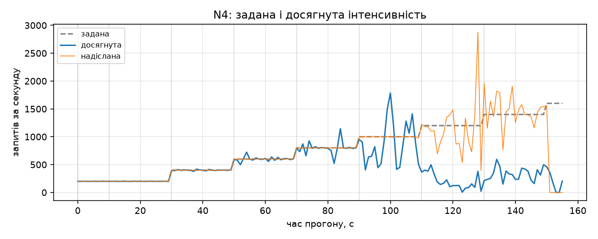
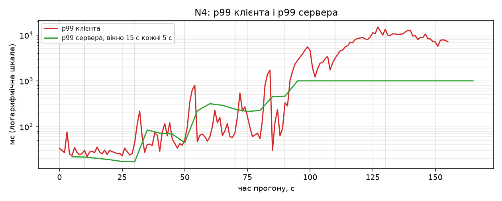
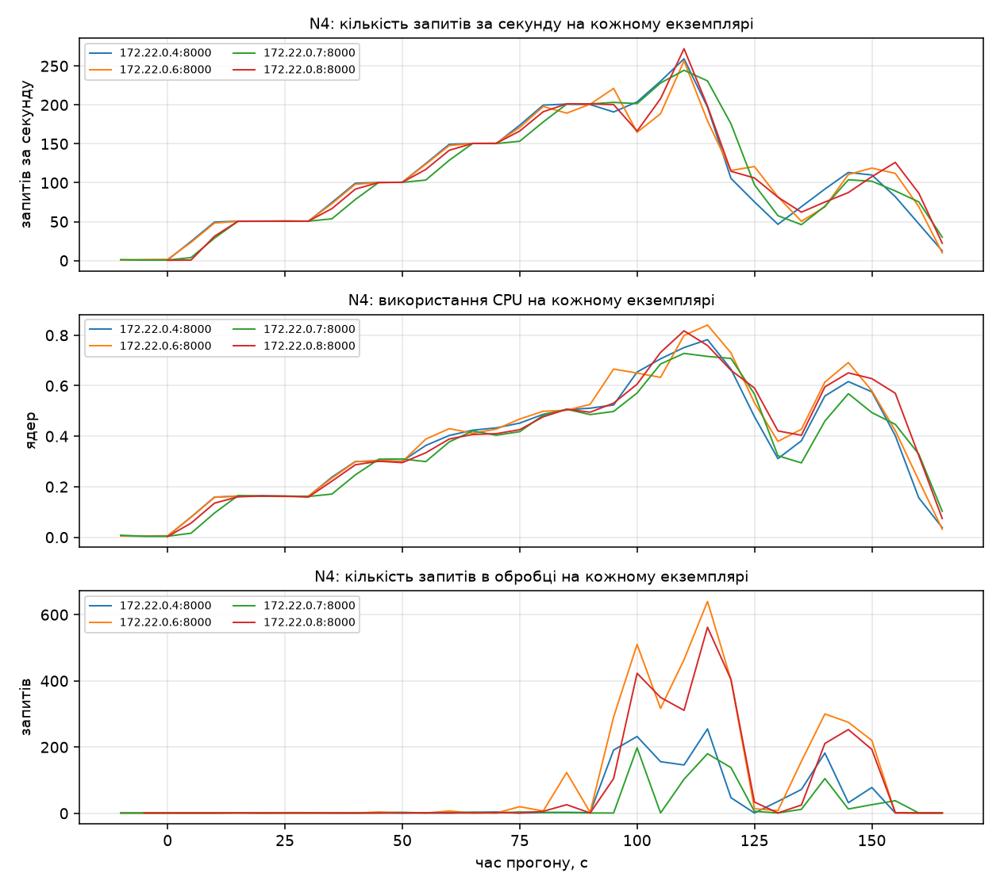
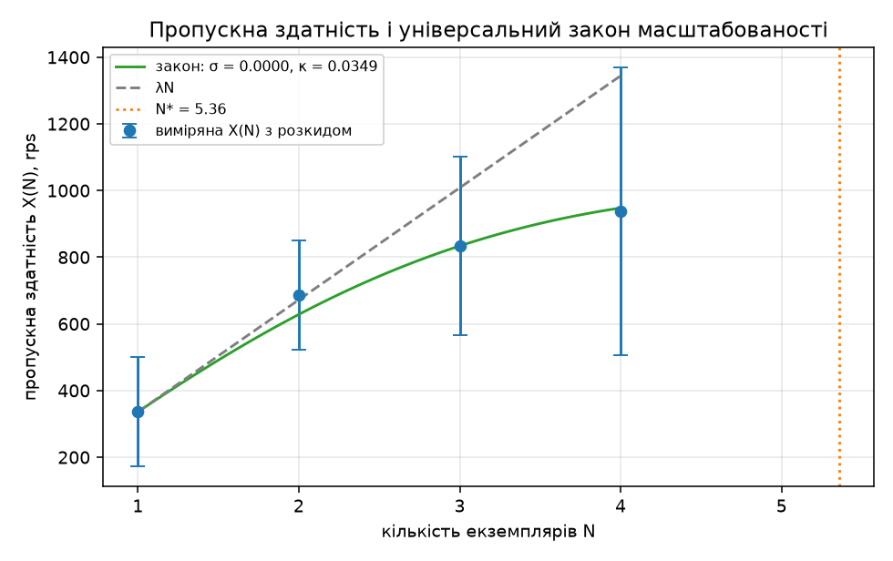
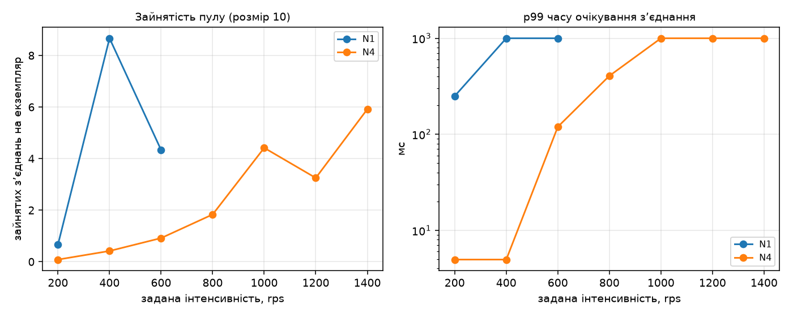

# Звіт: лабораторна робота 2. Метрики сервісу і межа масштабованості

**Варіант 19.** Сервіс із ЛР1: реєстр донорів, ресурс `/donor-registry` ([REPORT.md](REPORT.md)).

| Параметр варіанта | Значення |
|---|---|
| Розмір пулу зʼєднань | 10 (`DB_POOL_SIZE`, `min_size = max_size = 10`) |
| Бакети гістограми | Г1: 5, 10, 25, 50, 100, 250, 500, 1000 мс |
| Додаткова метрика | М1: зайняті зʼєднання пулу + гістограма часу очікування зʼєднання |
| Ліміти `web` | 1 CPU, 512 МБ — з ЛР1, не змінювались |

Запуск усіх вимірювань: [RUN-LAB2.md](RUN-LAB2.md). Сирі дані: `results/lab2/`.

## Умови

- Усе на одній машині: Windows 11, 8 логічних ядер, 15,8 ГБ ОЗП. Docker Desktop (WSL2): **8 CPU,
  7,6 ГБ** (`docker info`, у `results/lab2/docker_info.txt`).
- Інтервал збору Prometheus 5 с. Таймаут запиту 5 с, перевищення = відповідь не 2xx.
- Затримка рахується від **запланованого** моменту надсилання, тож черга видна в перцентилях.
- Розклад генератора на `time.perf_counter`, а не на годиннику циклу подій: на Windows
  `time.monotonic` має крок 15,6 мс, і запити вилітали б пачками. Плюс `timeBeginPeriod(1)`.
  Перевірка на локальній заглушці: p99 впав з 15,8 до 3,9 мс.

## Метрики Prometheus
`prometheus-client`, реєстрація один раз при старті модуля, оновлення в middleware
`observe_request` ([app/main.py](app/main.py)).

| Метрика | Тип | Мітки |
|---|---|---|
| `http_requests_total` | лічильник | `method`, `path`, `code` |
| `http_request_duration_seconds` | гістограма, бакети Г1 | `method`, `path` |
| `http_requests_in_flight` | вимірювач | — |
| `db_pool_connections_busy` | вимірювач | — (М1) |
| `db_pool_wait_seconds` | гістограма, бакети Г1 | — (М1) |
| `db_pool_size` | вимірювач | — |

Бакети в секундах за конвенцією: `BUCKETS_G1 = (0.005, 0.01, 0.025, 0.05, 0.1, 0.25, 0.5, 1.0)`.

У мітці `path` стоїть шаблон `/donor-registry/{id}`, а не конкретний id: Starlette кладе знайдений
маршрут у `scope["route"]`. Інакше сто записів дали б сто рядів. Незбіглі запити — мітка
`<unmatched>`.

Зайнятість пулу і час очікування міряє обгортка `acquire()`, через яку йдуть усі звернення до бази.
Метрики віддаються за `GET /metrics`, сервіс працює одним процесом (`uvicorn` без `--workers`), тож
`process_cpu_seconds_total` додає стандартний збирач бібліотеки. Зразок віддачі:
`results/lab2/metrics_sample.txt`.

## Ендпоінти і налаштування
| Що | Як |
|---|---|
| `GET /livez` | 200 і текст `ok`, до пулу не звертається |
| `X-Pod` | `POD_NAME`, інакше імʼя хоста контейнера; на кожній відповіді |
| `DB_POOL_SIZE` | 10; `min_size = max_size = 10`, зʼєднань понад пул немає |

`min_size = max_size` — щоб час відкриття зʼєднання не потрапляв у гістограму очікування: інакше
метрика М1 змішувала б очікування вільного зʼєднання і встановлення нового.

## Коректна зупинка
`CMD` в exec-формі, тож SIGTERM отримує сам `uvicorn`:

```dockerfile
CMD ["uvicorn", "app.main:app", "--host", "0.0.0.0", "--port", "8000", "--no-access-log", "--timeout-graceful-shutdown", "25"]
```

`uvicorn` перестає приймати зʼєднання, дочікує запити в обробці, `lifespan` закриває пул.
`stop_grace_period: 30s` > 25 с, щоб SIGKILL не прийшов раніше.

Перевірка [scripts/graceful_check.py](scripts/graceful_check.py): 200 rps на двох екземплярах,
`docker stop` одного контейнера.

| Що перевірялось | Результат |
|---|---|
| Код завершення контейнера | **0** |
| Зупинка тривала | 1,1 с |
| Не-2xx у вікні ±10 с | **0** |
| Помилки зʼєднання у вікні ±10 с | **0** |

**Чому довелось правити nginx.** З першого разу перевірка не пройшла: код був 0, але генератор бачив
відмови — у журналі балансувальника 499 з `urt ≈ 5,2 с`. У мережі Docker пакети на адресу зниклого
контейнера просто зникають, а типовий `proxy_connect_timeout` у nginx = 60 с, тож
`proxy_next_upstream` не встигав спрацювати до таймауту клієнта. Після `proxy_connect_timeout 2s`
перемикання вкладається в бюджет 5 с. Платою є сплеск p99 до 1246 мс на час перемикання, але це
2xx, а не відмова.

## Prometheus у Compose
Сервіс `prometheus` з томом `promdata` і портом 19090 на хост
([docker-compose.yml](docker-compose.yml)). Конфігурація збору:

```yaml
global:
  scrape_interval: 5s
scrape_configs:
  - job_name: web
    metrics_path: /metrics
    dns_sd_configs:
      - names: [web]
        type: A
        port: 8000
        refresh_interval: 5s
```

Окремий експортер не потрібен: М1 живе в самому сервісі. Після кожної зміни кількості екземплярів
балансувальник перезапускається — nginx розвʼязує імʼя `web` один раз при читанні конфігурації; це
робить і [loadgen/run_steps.py](loadgen/run_steps.py).

Після `--scale web=4` усі чотири цілі `web` у стані **UP** (`results/lab2/targets_scale4.json`).

## Ступінчастий профіль
[loadgen/step.py](loadgen/step.py): прогрів 10 с на 200 rps, далі сходинки по 20 с від 200 rps з
приростом 200 rps. Клієнт асинхронний, keep-alive, відкритий контур.

Посекундно пишуться: задана інтенсивність, фактична інтенсивність надсилання, досягнута
інтенсивність, 2xx, не-2xx, помилки зʼєднання, p50, p95, p99 клієнта (`results/lab2/N<k>.csv`).

- Досягнута інтенсивність за секунду = кількість відповідей 2xx, завершених у цю секунду.
- Середнє по сходинці — за останні 15 с; перші 5 с перехідні.
- X(N) = найбільша серед сходинок середня досягнута; розкид = стандартне відхилення посекундної
  досягнутої за ті самі 15 с.
- Зупинка: дві сходинки поспіль із досягнутою нижчою за 0,9 заданої, або сходинка, що досягла G.

Запити одної секунди надсилаються пачками за розкладом, а не зі сном на кожен: на високих
інтенсивностях інтервал менший за крок таймера. Навантаження розкладене на кілька процесів (GIL).

Сценарій: `GET /donor-registry/{id}`, сто попередньо занесених записів.

## Межа генератора G
У nginx доданий `location = /noop { return 204; }` — відповідь без звернення до `web`. Прогін
через той самий порт без обмеження G.

**G = 2797,3 rps** (розкид 1,8), сходинка 13. Це межа звʼязки генератор + nginx, не сервісу.

## X(N) на 1, 2, 3 і 4 екземплярах
| N | X(N), rps | Розкид, rps | Сходинка (задана, rps) | p99 клієнта, мс | p99 сервера, мс | Не-2xx, % | CPU на екземпляр, ядер | В обробці на екземпляр | Обмежено генератором |
|---|---|---|---|---|---|---|---|---|---|
| 1 | 336,1 | 163,8 | 1 (400) | 2198,5 | > 1000 | 0,00 | 0,801 | 274,3 | ні |
| 2 | 685,8 | 163,8 | 3 (800) | 3785,7 | > 1000 | 13,53 | 0,864 | 895,0 | ні |
| 3 | 833,7 | 268,0 | 3 (800) | 2618,5 | > 1000 | 0,00 | 0,641 | 100,3 | ні |
| 4 | 937,9 | 431,0 | 4 (1000) | 4423,7 | > 1000 | 6,36 | 0,774 | 267,6 | ні |

Жодна точка не обмежена генератором: найбільша X(N) = 938 rps це 34 % від G, і жоден прогін не
завершився з утриманою останньою сходинкою. Тому в підбір входять усі три точки з N > 1, а
зменшувати ліміт CPU не потрібно.

**Повторюваність.** Умова вимагає один прогін на кожне N, і наведена серія саме така. Але серію
проведено чотири рази, і розкид великий:

| Серія | X(1) | X(2) | X(3) | X(4) | Примітка |
|---|---|---|---|---|---|
| 1 | 399 | 676 | 601 | 600 | немонотонна |
| 2 | 400 | 402 | 583 | 600 | X(2) ≈ X(1) |
| 3 | 251 | 606 | 798 | 668 | стенд у поганому стані |
| **4 (наведена)** | **336** | **686** | **834** | **938** | монотонна |

Ще один прогін перервано: екземпляр не втримав 400 rps, хоча пряма проба постійною інтенсивністю в
той самий час давала 390 з 400. Причина розкиду — у розділі «Спільний ресурс і метрика М1»: вузьке місце це процесор хоста, а
його завантаження змінюється між прогонами. Тому σ і κ з однієї серії — оцінка порядку величини.

## Діаграми
Побудовані до видалення томів Compose, за `results/lab2/N<k>_prom.json` і посекундними записами
генератора ([scripts/charts.py](scripts/charts.py)).

| Прогін | Задана і досягнута | p99 клієнта і сервера | Екземпляри |
|---|---|---|---|
| 1 екземпляр |  |  |  |
| 4 екземпляри |  |  |  |

p99 сервера — на вікні 15 с з оновленням кожні 5 с.

## p99 клієнта проти p99 сервера
p99 клієнта рахує генератор від запланованого моменту надсилання. p99 сервера оцінений за
гістограмою і не містить часу в мережі та в черзі балансувальника.

```
Q(q) = b(i−1) + (b(i) − b(i−1)) · (r − c(i−1)) / (c(i) − c(i−1)),   r = q · n
```

Бакет `i` такий, що `c(i−1) < r ≤ c(i)`; похибка не перевищує ширини бакета. Прирости лічильників
беруться за 15 с сходинки і сумуються по всіх екземплярах ([loadgen/prom.py](loadgen/prom.py)).

| Сходинка | Задана, rps | p99 клієнта, мс | p99 сервера, мс | Бакет, мс | Макс. похибка, мс | Різниця клієнт − сервер, мс |
|---|---|---|---|---|---|---|
| 0 | 200 | 855,3 | 446,6 | (250; 500] | 250 | 408,7 |
| 1 | 400 | 2198,5 | > 1000 | (1000; ∞) | не обмежена | 1198,5 |
| 2 | 600 | 5443,2 | > 1000 | (1000; ∞) | не обмежена | 4443,2 |

- На першій сходинці різниця 409 мс — це час у черзі балансувальника і в мережі.
- Далі оцінка виходить за останню скінченну межу Г1 (1000 мс), тож «> 1000» і похибка зверху не
  обмежена. Різниця клієнт − сервер там є **нижньою** оцінкою черги.
- Максимальна похибка для Г1: 15 мс у бакеті (10; 25], 150 мс у (100; 250], 250 мс у (250; 500].
  На перевантажених сходинках сітка бакетів уже не розрізняє значення — це обмеження варіанта.

## Універсальний закон масштабованості
```
X(N) = λN / (1 + σ(N − 1) + κN(N − 1)),   C(N) = X(N) / X(1),   λ = X(1)
N / C(N) − 1 = σ(N − 1) + κN(N − 1)
```

| N | X(N), rps | C(N) | y = N/C(N) − 1 | u | v |
|---|---|---|---|---|---|
| 1 | 336,1 | 1,0000 | — | — | — |
| 2 | 685,8 | 2,0407 | −0,0199 | 1 | 2 |
| 3 | 833,7 | 2,4807 | 0,2094 | 2 | 6 |
| 4 | 937,9 | 2,7909 | 0,4332 | 3 | 12 |

Σu² = 14, Σv² = 184, Σuv = 50, Σuy = 1,6985, Σvy = 6,4149.

Двопараметрична оцінка дала **відʼємну σ**, бо y(2) < 0: вимірялось C(2) = 2,04, трохи більше за
ідеальні 2. За правилом з умови σ = 0, а κ за однопараметричною формулою:

```
σ = 0
κ = Σvy / Σv² = 6,4149 / 184 = 0,0349
λ = X(1) = 336,1 rps
N* = √((1 − σ) / κ) = 5,36,   X(N*) ≈ 993 rps
```



- **σ = 0** — частки роботи, що виконується послідовно на спільному ресурсі, у цих вимірюваннях не
  видно: до чотирьох екземплярів пропускна здатність ще зростає з кожним доданим.
- **κ = 0,0349 > 0** — витрати, що ростуть як N(N − 1), є. Узгодження стану між екземплярами тут
  немає (читання за первинним ключем, спільного стану немає), тож за цим κ стоїть конкуренція за
  процесор хоста.
- **C(2) = 2,04 > 2** — не надлінійність, а занижена λ: X(1) виміряна на сходинці, де один
  екземпляр уже захлинався (274 запити в обробці, 0,80 ядра з 1).
- **N\* = 5,36** — екстраполяція за межі виміряного (дані лише до N = 4), читати як «між 5 і 6».

## Спільний ресурс і метрика М1
На сходинці, де досягнуто X(4) (1000 rps, `docker stats --no-stream` кожні 2 с):

| Контейнер | CPU, % (середнє) | CPU, % (максимум) | Памʼять (останній знімок) |
|---|---|---|---|
| `donors-db-1` | 57,7 | 64,6 | 89.02MiB |
| `donors-lb-1` | 45,2 | 58,8 | 52.45MiB |
| `donors-prometheus-1` | 0,1 | 0,3 | 40.8MiB |
| `donors-web-1` | 99,7 | 111,0 | 105.2MiB |
| `donors-web-2` | 98,4 | 110,9 | 110.8MiB |
| `donors-web-3` | 95,4 | 123,4 | 70.71MiB |
| `donors-web-4` | 105,1 | 130,1 | 85.18MiB |

| Величина | Значення |
|---|---|
| CPU хоста, % (середнє за вікно) | 94,5 |
| CPU хоста, % (максимум) | 100,0 |
| CPU процесів генератора, ядер | 0,63 |
| Памʼять процесів генератора, МБ | 298,2 |
| Знімків у вікні | 6 |

Сума по контейнерах ≈ 5,0 ядра з восьми, генератор ще 0,63; решта — віртуальна машина Docker.

**Дві оцінки CPU екземпляра розходяться.** Метрика процесу `process_cpu_seconds_total` дає 0,77
ядра, `docker stats` — 95–105 %. Вони міряють різне: перша це час самого процесу uvicorn, друга —
весь час, який cgroup списала контейнеру, включно з обробкою мережі в ядрі. Обидві кажуть «близько
до ліміту», але довести, що екземпляр у нього **впирається**, не можна: для цього потрібен
лічильник дроселювання (`nr_throttled` / `nr_periods`), а це метрика М3, якої у варіанті 19 немає.

| Кандидат | Метрики | Висновок |
|---|---|---|
| CPU екземпляра | 0,77 ядра (процес) / 0,95–1,05 (`docker stats`), ліміт 1 | близько до ліміту |
| Памʼять екземпляра | 71–111 МБ з 512 | не межа |
| Пул зʼєднань (М1) | 4,4 з 10 на сходинці X(4) | не межа при N ≥ 2 |
| База | 58 % ядра, 89 МБ | не межа |
| Балансувальник | 45 % ядра, 52 МБ | не межа |
| **Процесор хоста** | **94,5 % у середньому, 100 % у піку** | **спільний ресурс** |

**Висновок: спільний ресурс це процесор хоста.** Кожен екземпляр підходить до власного ліміту
1 CPU, але ліміти не незалежні — чотири екземпляри, база, балансувальник, віртуальна машина Docker
і генератор ділять ті самі вісім ядер і разом вибирають 94,5 %. Пʼятому вже не було б звідки взяти
ядро — звідси κ > 0 і максимум при N\* ≈ 5,4.

### Метрика М1



Результат залежить від N:

| N | Зайнято зʼєднань на сходинці X(N) | Пул як межа |
|---|---|---|
| 1 | 8,7 з 10 (максимум 10) | **так, майже вичерпано** |
| 2 | 4,3 з 10 | ні |
| 3 | 1,2 з 10 | ні |
| 4 | 4,4 з 10 | ні |

На **одному** екземплярі пул справді близький до межі: 336 rps через 10 зʼєднань = ≈30 мс на
зʼєднання на запит. Для N = 1 розмір пулу з варіанта цілком може бути однією з причин коліна між
200 і 400 rps.

З додаванням екземплярів пул перестає бути вузьким місцем. На чотирьох є 40 зʼєднань, і якби межею
був пул, X(4) мала б наблизитись до 4 · 336 ≈ 1340 rps. Виміряно 938 при зайнятості 4,4 з 10 —
зʼєднання є, пропускної здатності немає.

p99 часу очікування зʼєднання вилітає за 1000 мс тоді, коли зайнято помітно менше за 10. Тобто
«очікування зʼєднання» тут здебільшого є часом у черзі циклу подій без процесора — той самий
дефіцит CPU з іншого боку.

Повна таблиця за сходинками:

| N | Сходинка | Задана, rps | Зайнято зʼєднань (середнє) | Зайнято (максимум) | p99 очікування зʼєднання, мс | Бакет, мс |
|---|---|---|---|---|---|---|
| 1 | 0 | 200 | 0,67 | 2 | 250,0 | (100; 250] |
| 1 | 1 | 400 | 8,67 | 10 | > 1000 | (1000; ∞) |
| 1 | 2 | 600 | 4,33 | 6 | > 1000 | (1000; ∞) |
| 2 | 0 | 200 | 0,00 | 0 | 5,0 | (0; 5] |
| 2 | 1 | 400 | 4,17 | 9 | 482,0 | (250; 500] |
| 2 | 2 | 600 | 2,83 | 7 | > 1000 | (1000; ∞) |
| 2 | 3 | 800 | 4,33 | 9 | > 1000 | (1000; ∞) |
| 3 | 0 | 200 | 0,11 | 1 | 5,0 | (0; 5] |
| 3 | 1 | 400 | 0,44 | 2 | 23,4 | (10; 25] |
| 3 | 2 | 600 | 1,22 | 10 | 217,9 | (100; 250] |
| 3 | 3 | 800 | 1,22 | 4 | > 1000 | (1000; ∞) |
| 3 | 4 | 1000 | 6,56 | 10 | > 1000 | (1000; ∞) |
| 3 | 5 | 1200 | 4,67 | 7 | > 1000 | (1000; ∞) |
| 4 | 0 | 200 | 0,08 | 1 | 5,0 | (0; 5] |
| 4 | 1 | 400 | 0,42 | 2 | 5,0 | (0; 5] |
| 4 | 2 | 600 | 0,92 | 4 | 119,5 | (100; 250] |
| 4 | 3 | 800 | 1,83 | 7 | 406,1 | (250; 500] |
| 4 | 4 | 1000 | 4,42 | 9 | > 1000 | (1000; ∞) |
| 4 | 5 | 1200 | 3,25 | 6 | > 1000 | (1000; ∞) |
| 4 | 6 | 1400 | 5,92 | 10 | > 1000 | (1000; ∞) |

## Використання генеративних моделей

**Оформлення тексту.** Структура розділів, зведення чисел у таблиці.

**Помилки, знайдені й виправлені під час роботи:**

- Перевірка коректної зупинки не проходила через `proxy_connect_timeout` 60 с у nginx (розділ «Коректна зупинка»).
- Затримки мірялись із кроком 15,6 мс: розклад спирався на годинник циклу подій, а не на
  `perf_counter` (розділ «Умови»).
- `self._stop` у збирачі `docker stats` перекрив `Thread._stop`; прогін падав з
  `TypeError: 'Event' object is not callable` уже після запису результатів.
- Знімки CPU хоста писались зі зсувом 3 год: `Get-Date -UFormat %s` повертає локальний час.
- Запит CPU без фільтра `job="web"` захоплював і сам Prometheus, через що середнє на екземпляр
  ділилось на два.
- Docker Desktop двічі не стартував через застарілі файли сокетів у `%LOCALAPPDATA%/Docker/run` і
  окремо втрачав проброс портів на хост. [loadgen/run_steps.py](loadgen/run_steps.py) тепер
  пересоздає балансувальник, якщо за 30 с немає жодної відповіді.
